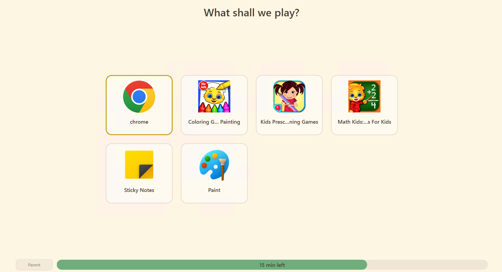
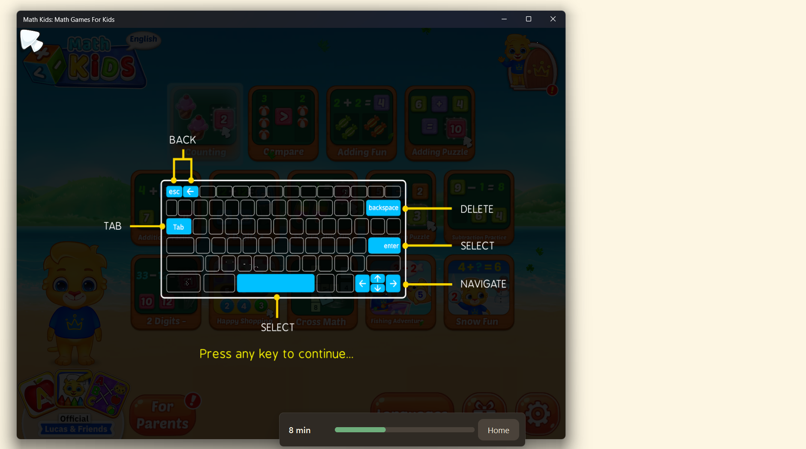
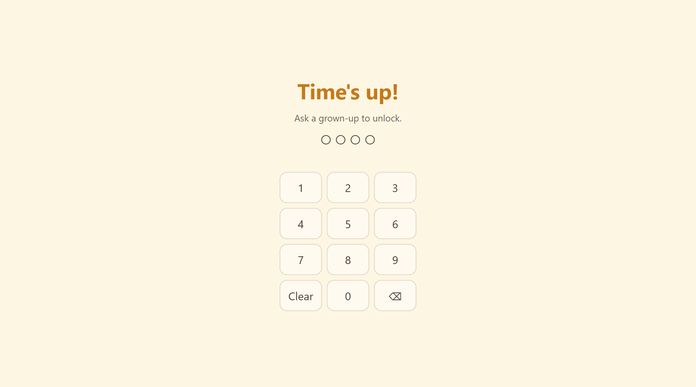
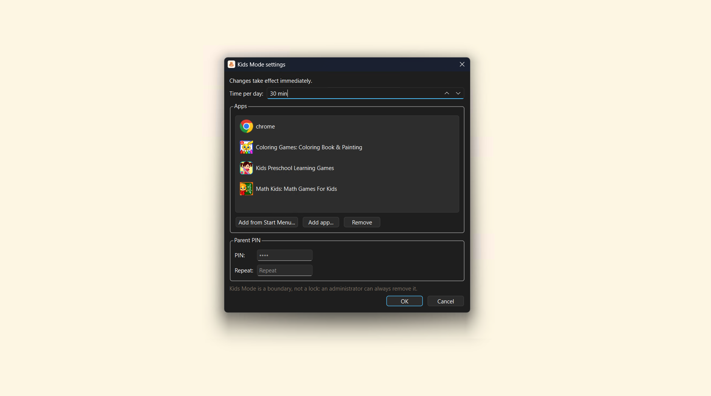
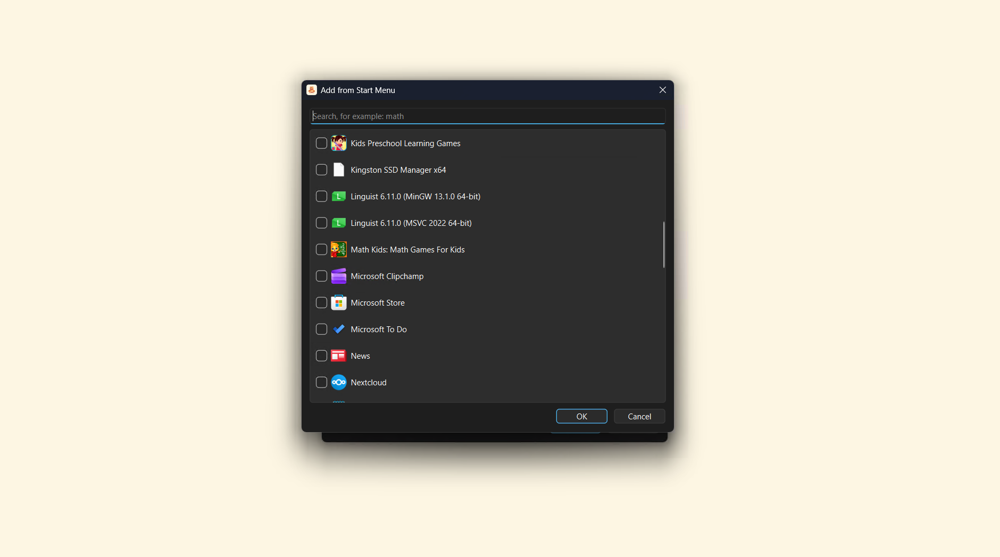
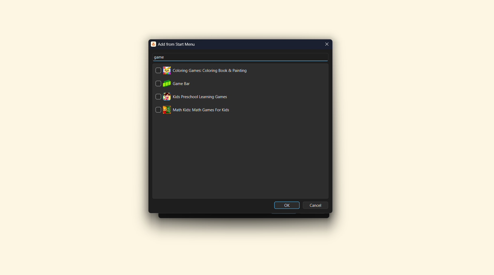

# Kids Mode

A calm, full-screen launcher for a Windows PC a child shares: they pick from only the apps a
parent approved, get a fixed amount of time each day, and when the time runs out the screen
gently locks until a grown-up types a PIN. No desktop, no icons, no way to wander off — and no
account the child can get locked out of.



**It is a boundary, not a lock.** It is a UI convenience, not parental control: Task Manager,
Ctrl+Alt+Del, another Windows account or a reboot can get around it. That is accepted — this is
a family tool for a shared PC, not surveillance or a walled garden.

## What it does

- **One screen the child trusts.** The launcher fills the whole display. While an app runs, the
  launcher stays behind it as a plain cream backdrop, so the desktop and its icons never flash
  into view around a small window.
- **A daily time limit**, counted only while the launcher or the approved app is actually on
  screen. Warnings at 5 and 1 minute (amber, never alarming red). The count is saved, so a
  restart or reboot does not refill the day.
- **A friendly lock** when time is up, with a big touch-friendly keypad — a parent types the PIN,
  then chooses **Add 15 minutes** or **Quit Kids Mode**.
- **Approved apps only.** Add them by name from the Start Menu — the same names and icons
  Windows shows — or point at an `.exe`. Store games like Math Kids or Coloring Book work too.
- **A parent way out**, always: a small **Parent** button (or a two-second hold on the time bar).
- **Everything logged, nothing phoned home.** `kidsmode.log` records every launch and state
  change. There is no network, no telemetry, no account.

## Screens

<table>
  <tr>
    <td width="50%">
      <br>
      <sub>An approved game running. The cream backdrop hides the desktop; the small bar shows
      time left and <b>Home</b>.</sub>
    </td>
    <td width="50%">
      <br>
      <sub>Time's up. A big keypad a parent can use with a finger or a mouse.</sub>
    </td>
  </tr>
  <tr>
    <td width="50%">
      <br>
      <sub>Everything a parent sets, in one plain dialog: the daily limit, the approved apps,
      the PIN. Changes take effect immediately.</sub>
    </td>
    <td width="50%">
      <br>
      <sub>Parents add apps by name — no file paths, no hunting through folders.</sub>
    </td>
  </tr>
  <tr>
    <td colspan="2">
      <br>
      <sub>Type <b>game</b> and the list shrinks to the games — Store games included.</sub>
    </td>
  </tr>
</table>

## Get it

Download **`KidsMode-Setup.exe`** from the [latest release](https://github.com/giftofsky/KidsMode/releases/latest)
— one offline file, about 45 MB, that includes everything it needs (no Qt or developer tools
required). It installs for the current user only and asks for no administrator rights.

## Set it up (about two minutes)

1. **Log in as the child** and run Kids Mode. First launch asks for a 4-digit PIN, a daily
   limit, and at least one app.
2. Press **Add from Start Menu…** and tick the apps and games your child may open — type
   "game" to see just the games. Store games included.
3. Add a shortcut to the child's Startup folder (`Win+R` → `shell:startup`) so Kids Mode opens
   on its own at sign-in. The setup installer can do this for you.
4. To change the limit or apps later: press **Parent**, enter the PIN, choose **Settings…**.

To reset everything, delete `%APPDATA%\KidsMode\` and run it again. The settings and today's
usage are two readable JSON files in that folder — nothing is hidden, and a child who edits them
has outgrown the tool.

## How it works

Kids Mode is a normal Windows program: a full-screen window that stays on top, launches one
approved app at a time, and watches the clock. Some Store apps (`calc`, Windows 11 `notepad`)
are tiny stubs whose window belongs to another process; Kids Mode follows the window they open
and closes that window when time is up. Chrome and Edge are given their own profile so a launch
can't hand off to an already-open window and vanish. When the child minimizes or an app steals
focus, a one-second guard puts the screen back. None of it needs elevated rights, and none of it
is a security boundary — see the honest note up top.

## Build from source

Qt 6 Widgets, C++20, CMake. No third-party libraries.

```
cmake -S . -B build -G "Visual Studio 17 2022" -A x64 -DCMAKE_PREFIX_PATH=E:/Qt/6.11.0/msvc2022_64
cmake --build build --config Release
ctest --test-dir build -C Release --output-on-failure
```

To produce the installer, build the Release target and run
`powershell -File installer\build-installer.ps1`; it stages the app with `windeployqt` and packs
a single offline `KidsMode-Setup.exe` with the Qt Installer Framework.

## License

LGPLv3. Qt is linked dynamically and its DLLs are shipped with the app via `windeployqt`; the
app does not build Qt statically and does not modify it. The app icon uses the Teddy bear emoji
from [Microsoft Fluent Emoji](https://github.com/microsoft/fluentui-emoji) (MIT) — see
[CREDITS.md](CREDITS.md).
